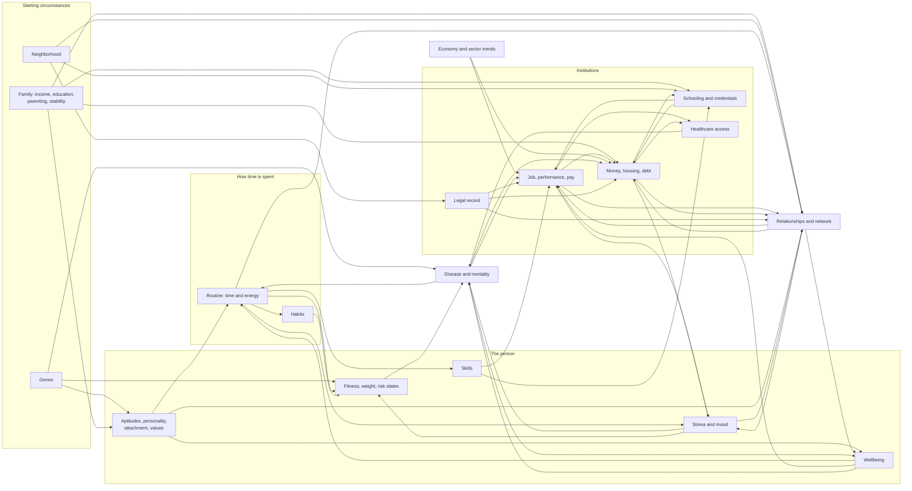

# Lifesim — Design Document

**Status:** Approved on 2026-11-10 with all twelve proposals in §1 accepted. Milestones 1 and 2 are
built; see [CALIBRATION.md](CALIBRATION.md) for results so far. One accepted decision is not yet
implemented: race and ethnicity (Q1), see item 40 in §17.
**Settings:** United States · born 2026, simulated forward · browser app in TypeScript, no backend · English.

This document describes what is being built and why. Section 1 records the decisions taken at
review; §17 records the calls made along the way. Any of it can be reopened.

## Contents

1. [Decisions taken at review](#1-decisions-taken-at-review)
2. [What version 1 is](#2-what-version-1-is)
3. [Core modeling ideas](#3-core-modeling-ideas)
4. [Architecture](#4-architecture)
5. [Time model](#5-time-model)
6. [State model](#6-state-model)
7. [Systems](#7-systems)
8. [Causal map](#8-causal-map)
9. [Event model](#9-event-model)
10. [Narrative and text](#10-narrative-and-text)
11. [Perception and interface](#11-perception-and-interface)
12. [Data formats and the country pack](#12-data-formats-and-the-country-pack)
13. [Calibration targets](#13-calibration-targets)
14. [Testing](#14-testing)
15. [Milestones](#15-milestones)
16. [Cuts and deferrals](#16-cuts-and-deferrals)
17. [Decisions I have made](#17-decisions-i-have-made)
18. [Risks](#18-risks)
19. [Appendices](#19-appendices)

---

## 1. Decisions taken at review

These were the scope, tone and major trade-off questions put to the project owner. **All twelve
proposed answers were accepted on 2026-11-10** and are now part of the design.

| # | Question | Decision | Why it was the owner's call |
|---|----------|-----------------|-----------------|
| Q1 | **Race and ethnicity.** In the US they are among the strongest structural predictors of wealth, neighborhood, health and contact with the justice system. Do we model them? | Yes. Every person has a race/ethnicity attribute drawn from real birth data. Most of the disparity enters through **starting circumstances** (parental income and wealth, neighborhood, school quality), which are drawn from joint distributions that already contain it. On top of that, a small set of **documented direct effects** (hiring callback gaps, police stop and arrest rates, mortgage pricing) are data-driven modifiers with cited sources, and they appear in "Why?" in plain language. The player can pick or randomize. | Leaving it out makes the US model wrong in ways the calibration will show; putting it in is a tone commitment. |
| Q2 | **Sex and gender effects.** Same question for the pay gap and the uneven division of care work. | Model the mechanisms rather than a flat penalty: occupation sorting, hours, career interruptions around childbirth, and the default housework and childcare split negotiated between partners. Add a small residual pay modifier only if the mechanisms alone miss the measured gap by a wide margin, and document it. Sex at birth, gender identity and sexual orientation are attributes of every person; orientation shapes the dating pool. | Same reason as Q1. |
| Q3 | **Suicide and the player character.** Depression and suicidal thinking will exist in the simulation. | NPCs can die by suicide at real base rates, with warning signs and risk factors. For the **player character**, severe depression surfaces suicidal thoughts as a serious symptom, narrated carefully, with paths to help. The game neither kills the player character by suicide on a dice roll nor offers it as a button. This is a deliberate deviation from the cause-of-death table and will be recorded in the calibration document. | Tone and duty of care. |
| Q4 | **Abuse and sexual violence.** Childhood adversity matters causally. | Model adverse childhood experiences that arise from the parents' own simulated lives: neglect, harsh or violent discipline, household addiction, domestic violence, parental incarceration, mental illness, divorce. Narrate them plainly, never graphically. **Sexual violence is not depicted in v1**, neither against nor by the player or any NPC. The player's crime options exclude sexual offenses, crimes against children and premeditated murder. | Tone. |
| Q5 | **Money: nominal or constant dollars?** Over 90 years, 2.5% inflation multiplies prices by nine. | Simulate in **nominal dollars** with an inflation process, because inflation has real effects we want (cash erodes, fixed-rate mortgages get lighter, wages lag in a spike). Tax brackets and benefits are indexed. The UI shows nominal amounts with a toggle for "in 2026 dollars"; the batch tool deflates everything before comparing with real statistics. | Affects how every number in the game reads. |
| Q6 | **Mortality in the future.** Use today's life table, or project improvement for someone born in 2026? | Use the **current period life table** with no projected improvement, so "matches the real country" is checkable. An annual improvement rate is a data parameter, default 0. | Trade-off between calibration and plausibility of the future. |
| Q7 | **How much does the future change?** | Institutions are frozen in real terms: today's tax code, benefit programs, school system and healthcare financing persist, indexed to inflation. The economy has cycles, and industries drift by seeded random walks (so some occupations decline over a lifetime), but there are no named technologies, wars, pandemics or policy revolutions. Social Security pays scheduled benefits. | "Plausible, unspecified future" could mean more than this. |
| Q8 | **Routine adherence.** I propose that the routine the player sets is a *plan*, and what the character actually does depends on habit strength, stress, mood and conscientiousness. ("You meant to run four times a week. Most weeks it was once.") | Include it, with clear feedback about why adherence is low and what would raise it. It is the main mechanism behind "habits have inertia" and gives personality real bite. The risk is that players feel robbed of control; mitigation is in §7.6. | It is the biggest single gameplay trade-off in the design. |
| Q9 | **Starting conditions.** | Default is "roll a life": family, place and genes are drawn from real US distributions. The player may fix sex, name and state, re-roll, or enter a seed. No difficulty setting; the starting draw *is* the difficulty, and the game says so honestly. | Scope and tone of the opening. |
| Q10 | **Real or fictional institutions.** | Real states and metro areas. **Fictional** schools, colleges, employers and hospitals, generated from name grammars and stable for the life of the save. Avoids inaccuracy and unfairness toward real organizations and removes a maintenance burden. | Affects the feel of the prose. |
| Q11 | **Military service** is a major US path, especially for lower-income families. | **Defer past v1.** Done properly it needs enlistment, training, deployment, injury and trauma, the VA and the GI Bill; done thinly it would break the "depth over breadth" rule. The occupation schema leaves room for it. | A scope cut you might not expect. |
| Q12 | **Occupation count for v1.** | About 45 well-modeled occupations at Milestone 3 (list in Appendix A), growing to 100+ by the end of Milestone 7. Since the catalog is data, growth needs no engine work. | You asked for "eventually 100 or more"; this is the schedule. |

---

## 2. What version 1 is

One person's life in the United States, from birth in 2026 to death, read and played in about three
hours, followed by the option to continue as a descendant.

### 2.1 The pacing budget

Three hours over roughly 80 years is the hardest constraint in the brief, so it gets a budget that
every system has to live within.

| Life stage | Ages | Minutes per year | Total | What the player is doing |
|------------|------|------------------|-------|--------------------------|
| Early years | 0–5 | <1 | 5 | Reading three short chapters produced by the family simulation. No decisions. |
| Childhood | 6–12 | 1 | 7 | Small choices: effort, friends, activities, obedience. Parents decide the big things. |
| Adolescence | 13–17 | 3 | 15 | Routine opens up. Courses, peers, first jobs, first relationships, risk. |
| Early adulthood | 18–30 | 3.5 | 45 | The densest period: education, first career, partners, moves, debt. |
| Midlife | 31–50 | 2 | 40 | Career, children, housing, aging parents. Many quiet years, some heavy ones. |
| Late career | 51–65 | 1.5 | 22 | Health starts to speak. Retirement planning, adult children. |
| Old age | 66+ | 1.5 | 25 | Health, loss, legacy, time. |
| Ending | — | — | 10 | Obituary, legacy, choosing who to continue as. |
| | | | **≈170** | |

A typical year is: read the summary (100–200 words), adjust the routine or a standing policy if
something changed, resolve zero to three decisions, advance. An **interrupt governor** (§5.3)
enforces this.

### 2.2 How tedium is abstracted

The player manages a life the way a person does: through a weekly routine, a few standing policies,
and decisions when something comes up. They never perform monthly chores.

- **Routine:** hours per week by category (§7.6).
- **Standing policies:** spending level, saving and debt priorities, how hard to push at work, whether
  to look for another job, who to prioritize socially, whether to keep up with checkups.
- **Decisions:** arrive with context, costs and a deadline.
- **Actions:** things the player initiates (apply, ask, call, see a doctor, move), each with a cost in
  time, money and energy.

Everything else (paying bills, filing taxes, buying groceries) runs on autopilot and shows up only
through its consequences.

---

## 3. Core modeling ideas

Five ideas carry most of the design. They are stated once here and reused in every system.

### 3.1 Slow variables are stocks that approach a target

Fitness, weight, skill, closeness, trust, habit strength, reputation and stress load are all
**stocks**. Each month a stock moves a fraction of the way toward a target set by current behavior
and circumstances, inside an envelope set by age and genes:

```
x ← x + (target − x) · (1 − exp(−Δt / τ))
```

`τ` differs by direction: fitness is lost faster than it is gained, trust the reverse. This one
primitive gives diminishing returns, inertia and compounding without special cases. One gym visit
does nothing because one month at a new target with τ of eight months moves the stock very little;
three years gets you nearly all the way.

| Stock | Rough time constant | Note |
|-------|--------------------|------|
| Mood | weeks | Fast, event-driven |
| Acute stress | 1–3 months | |
| Cardio fitness | gain 6–9 months, loss 3–4 months | Envelope falls with age |
| Habit strength | 2–3 months to form | Lally et al. 2010: median 66 days |
| Body weight | 1–2 years | Genetic set point; drifts up with age |
| Reputation at work | 1–2 years | |
| Income reference point | 1–2 years | Hedonic adaptation (§7.7) |
| Closeness without contact | half-life 1–3 years for friends, 5–10+ for kin and old friends | |
| Trust | builds over years, breaks at once | |
| Allostatic (chronic stress) load | years | Feeds disease hazards |
| Values | a decade or more | |
| Personality | decades | |

Skills use hours of practice rather than a time constant (§7.5), but follow the same shape.

### 3.2 Discrete outcomes come from additive models with named factors

Every probabilistic outcome (hired or not, diagnosed or not, divorce or not, caught or not) is
computed as

```
logit(p) = logit(base rate for this population) + Σ βᵢ · factorᵢ(state)
```

or, for things that can happen in any month, as a hazard

```
h = h₀(age, sex) · exp(Σ βᵢ · factorᵢ(state)) / Z
```

where the base comes from real data and `Z` is a normalization constant computed by the batch tool
so the simulated *population* still reproduces the real base rate. (If smokers die at 2.5 times the
rate and 11% of people smoke, the non-smoker baseline has to sit below the table value.)

Each factor has an id, a plain-language phrase and a visibility level. The **same structure that
decides the outcome is stored and later shown** as the answer to "Why?" (§10.4). Explanations cannot
drift out of sync with the simulation, because they are the simulation.

### 3.3 Things that take time are processes

A job search, a pregnancy, a depressive episode, a failing employer, a parent's decline, a criminal
case and a strained marriage are all instances of a **process**: a data-defined state machine with
stages, durations, monthly effects, transitions, warning signs and decision points (§9.2). Processes
are how events unfold over time instead of popping up.

### 3.4 The player is a person like any other

The player character and every fully simulated NPC share one `Person` structure and run through the
same systems. The only difference is where decisions come from: commands for the player, a
personality-driven **policy** for NPCs. Three consequences:

- Childhood is living inside someone else's simulation. Your father loses his job because the
  economy system laid him off, not because a "dad loses job" event fired.
- Continuing as a child is a promotion, not a conversion. The child already has a full state that
  carries everything their upbringing did.
- The NPC policy doubles as the batch tool's AI player and as the in-character default when the
  player lets a deferrable decision lapse.

### 3.5 The player sees a perceived world

The UI never receives raw state. The engine exposes `perceive(state) → PlayerView`, which turns
hidden numbers into words, bands, observed behavior and institutional feedback (§11). Imperfect
information is enforced at the API boundary rather than left to UI discipline.

---

## 4. Architecture

### 4.1 Modules

```
src/
  engine/          Pure TypeScript. No DOM, no Node APIs, no clock, no Math.random. Depends only on zod.
    core/          keyed rng, deterministic math, time, expression language
    content/       content schemas, validator, preparation (expressions parsed, lookups indexed)
    systems/       one file per system: body, mortality, processes, events, decisions, actions,
                   perception and the year summary
    country/       the rules interface, and one folder per country for logic no table can hold
                   (us/: family formation, stub earnings, the school system)
    state.ts       the game state schema, from which its types and save validation both come
    context.ts     adjustStock and emitFact: the two doors all state changes go through
    engine.ts      createLife, step, tick, replay
    view.ts        perceive: GameState → PlayerView
    save.ts        export, import, migrations, state hashes
    invariants.ts
  narrative/       the narrator (templates → prose), year summary, obituary, "Why?" phrasing
  content/         compiles the authored files into one validated bundle (used by tools and by Vite)
  app/             the worker that hosts the engine in the browser, autosave, and the message protocol
  ui/              Preact app. Imports only the app protocol: the player's view and the commands.
  tools/           batch simulator, AI players, content validator, replay
content/           authored data: YAML and CSV (see §12)
tests/
docs/              DESIGN.md, CALIBRATION.md
```

Import boundaries are enforced by a test (`tests/architecture.test.ts`): `engine` imports nothing
outside itself but zod; `ui` reaches the game only through the app protocol; and neither the engine
nor the narrator may mention the clock, the DOM, `Math.random` or the non-deterministic `Math`
functions. The decision policy for NPCs gets its own `engine/policy/` folder in Milestone 4; until
then the AI players live in `tools/players.ts`.

### 4.2 Engine API

```ts
createLife(options: { seed: string; start?: StartOptions }, env: EngineEnv): GameState
step(state: GameState, command: Command, env: EngineEnv): StepResult
replay(source: { seed; options; commands }, env: EngineEnv): GameState

interface EngineEnv {
  content: Prepared           // the compiled content bundle
  narrator?: Narrator | null  // turns facts into prose; the simulation is identical without one
}

type Command =                // later milestones add setRoutine and continueAs
  | { type: 'advance'; until: 'month' | 'season' | 'birthday' }
  | { type: 'decide'; decisionId: string; optionId: string }
  | { type: 'setPolicy'; policy: Partial<StandingPolicies> }
  | { type: 'act'; action: string; choice?: string }

interface StepResult {
  state: GameState
  facts: Fact[]               // structured record of what happened, in order
  pending: Decision[]         // decisions waiting for the player
}

perceive(state: GameState, content: Prepared): PlayerView          // everything the UI may know
explainOutcome(state, content, outcomeId): Explanation             // in the narrative module
```

`step` is a pure function of `(state, command)` given the content. In the browser the engine runs
in a Web Worker so the page never blocks; in Node the batch tool calls it directly.

The narrator is passed in rather than imported, so the engine has no dependency on wording. Prose
is stored in the life log as it was shown, so later text changes never rewrite a life that has
already been lived, and a separate `simulationHash` (state without prose) is what determinism tests
compare.

### 4.3 Determinism

- **Keyed, stateless randomness.** A draw is `rng(seed, key…)`, a hash of the life seed and a key
  such as `('health.onset', personId, month, conditionId)`. There is no RNG cursor in the state.
  Adding a new system or event does not shift anyone else's draws, so seeded regression lives
  survive content growth, and any single draw can be reproduced in isolation.
- **Paired counterfactuals.** Because draws are keyed, the same life can be re-run with one thing
  changed (never smoked, born one income quintile higher) and all unrelated luck stays identical.
  This makes the causal checks in §13.3 cheap and low-variance.
- **Text has its own stream.** Template variant choice never touches simulation keys, so rewording
  text cannot change a life.
- **Replay** is `seed + command log + engine version + content hash`. Saves store all four.
- **Numbers.** Money is integer cents. `Math.exp`, `Math.log` and `Math.pow` are not guaranteed
  bit-identical across JavaScript engines, so the engine uses its own small implementations of
  these; replays are then identical across browsers and Node.
- In development builds, drawing twice from the same key in one tick throws.

### 4.4 Explainable state

All mutation goes through two functions:

```ts
adjust(target, variable, delta, cause)   // gradual change: accumulates in the yearly ledger
resolve(outcomeSpec, context)            // discrete outcome: evaluates the factor model, records it
```

- The **ledger** keeps, per person, per variable, per year, the summed contribution of each cause
  ("cardio fitness: +0.04 running, −0.01 aging, −0.02 the months after the knee injury"). It feeds
  the year summary and gradual-change explanations. It is compacted after a few years to the top
  causes.
- An **OutcomeRecord** stores the base rate, every factor's contribution, the draw and the result
  for each significant discrete outcome. It is kept for life and is what "Why?" reads.

### 4.5 Level of detail for people

| Tier | Who | Count | Representation | Update |
|------|-----|-------|----------------|--------|
| A — full | Household, partner, children, parents, siblings, closest friends, current manager | 10–25 | Full `Person`, same systems as the player | Monthly |
| B — coarse | Friends, colleagues, classmates, extended family, exes, neighbors | 50–200 | Compact record: traits summary, job, place, partnership, health band, relationship edge, memories | Yearly life-course transitions, plus on contact |
| C — statistical | Everyone else | none | Distributions conditioned on context (this school, this employer, this neighborhood, this dating pool) | People are generated from them on first encounter |

- **Promotion** (B→A) happens when a role demands it (partner, housemate) or when closeness and
  contact cross a threshold. Missing detail is generated from a key based on the NPC's id, so it is
  deterministic, and it must be consistent with a **known-facts record**: anything the player has
  been told stays true.
- **Demotion** (A→B) happens after years of low contact. Memories and known facts are kept.
- Tier B transitions (job change, move, marriage, child, divorce, illness, death) use the same
  base-rate tables as the full simulation, so the tiers agree statistically. The batch tool checks
  this.

### 4.6 Saves

- Autosave to IndexedDB after every command. Export and import as a JSON file.
- A save contains `schemaVersion`, engine version, content hash, seed, the command log and the
  current state snapshot.
- Migrations are a chain of `vN → vN+1` functions, each tested against a stored fixture save from
  version N. Content ids that are renamed or retired go through an alias table.
- Loading under newer content is supported (state refers to ids). Bit-exact *replay* is promised
  only for the same engine version and content hash.

### 4.7 Stack

| Choice | Reason |
|--------|--------|
| TypeScript, `strict` and `noUncheckedIndexedAccess` | Strong typing, as required |
| Vite + Vitest | Fast, standard, runs the engine tests in Node without a browser |
| Preact, plain CSS with custom properties | A text UI needs little; small bundle; replaceable because the engine is separate |
| Zod schemas for content and saves | Types are inferred from the schemas, so there is one source of truth |
| YAML for authored content, CSV for tables | Readable multi-line text and reviewable diffs. A build step validates everything and emits one hashed JSON bundle |
| A small expression language for conditions and weights | Content must not need engine changes, and must never be `eval`ed (§12.2) |
| Service worker, added late | With no backend the game can be installable and work offline at little cost |

### 4.8 Performance budget

- Advancing one year in the browser: under 150 ms on a mid-range phone.
- Node: under 20 ms per simulated year, so 1,000 lives run in a few minutes on 8 cores (the normal
  balancing loop) and 10,000 lives run as a nightly job.
- The cost is dominated by Tier A person-months (about 250 per year). Events are indexed by the
  subject type and life stage they can apply to, so each person evaluates dozens, not hundreds.

---

## 5. Time model

### 5.1 Resolution

The tick is **one month**. Weekly ticks would cost four times as much without changing any decision
the player makes. Finer timing appears where it matters: events carry a day for ordering and for
prose, and legal and hiring processes count in weeks and are mapped onto months.

The default turn runs **to the next birthday** and is labeled by age ("Age 34 · 2060"). School
years, tax years and leases follow the calendar internally. The player can instead advance one
month or one season at any time.

### 5.2 Order of work within a month

Phases run in a fixed order, and each phase runs for all Tier A people before the next begins, so
nobody acts on information from later in the same month.

1. **World:** business cycle, unemployment, inflation, interest rates, asset returns, sector trends,
   local housing prices.
2. **Processes and schedule:** advance every active process; fire scheduled items (school term
   starts, lease ends, review due).
3. **Routine realized:** planned hours → actual hours (adherence), energy balance, fatigue.
4. **Body, skills and habits** update from actual hours.
5. **Work and school:** performance, learning, grades, standing with the manager.
6. **Money:** income, withholding, benefits, bills, debt service, investment returns, shortfall
   handling.
7. **Health hazards:** latent risk states drift; onsets, symptoms, injuries, deaths.
8. **NPC decisions:** Tier A policies choose actions. In the birthday month of each Tier B person,
   their yearly transitions run.
9. **Relationships:** contact, drift, memory decay, news traveling through circles.
10. **Event selection** (§9.3).
11. **Appraisal:** stress, mood, domain satisfactions, wellbeing.
12. **Interrupt check, logging, ledger roll-up.**

### 5.3 Interrupts

A time skip stops when a decision is waiting. Decisions come in three classes:

| Class | Example | Behavior |
|-------|---------|----------|
| Blocking | A proposal; a diagnosis with a treatment choice; arrest | Stops the advance now. |
| Deferrable | A job offer due in three weeks; a friend asking for a loan | Stops the advance, but can be left open until its deadline. If it lapses, the character acts in character (policy default) and the log says so. |
| Informational | A colleague left; rent is going up in March | Goes to the feed. Never stops time. |

The **interrupt governor** keeps to the pacing budget. When a year is already crowded it delays
low-stakes deferrable decisions and suppresses optional event offers. It never drops or delays
anything that is causally required (a deadline, a legal step, a medical emergency).

---

## 6. State model

All state is plain serializable data: no classes, no `Map`s, string ids. A sketch of the shape
(field lists abbreviated):

```ts
interface GameState {
  meta: { schemaVersion; engineVersion; contentHash; seed; commandLog: Command[] }
  now: MonthIndex
  playerId: PersonId
  lineage: PersonId[]                    // earlier player characters in this save
  world: WorldState                      // macro economy, sector indices, price level, per-place indices
  people: Record<PersonId, Person>       // Tier A
  acquaintances: Record<PersonId, CoarsePerson>   // Tier B
  relationships: Record<EdgeId, Relationship>
  circles: Record<CircleId, Circle>      // friend groups, teams, classes, congregations, families
  households: Record<HouseholdId, Household>
  orgs: Record<OrgId, Organization>      // employers, schools, colleges
  processes: Record<ProcessId, ProcessInstance>
  schedule: ScheduledItem[]
  decisions: Decision[]                  // open decisions
  log: LifeLogEntry[]                    // the searchable life log
  outcomes: Record<OutcomeId, OutcomeRecord>
  ledger: CauseLedger
  accounts: Record<AccountId, Account>   // double-entry money (§7.14)
}

interface Person {
  id; name; born: MonthIndex; died?: { at: MonthIndex; cause: string }
  sex; gender; orientation; ethnicity
  genes: Record<GeneticTraitId, number>          // latent z-scores, inherited
  body: { height; weight; cardio; strength; sleepQuality; systems: Record<BodySystemId, number>;
          bp; lipids; glucose;                    // silent risk states, seen only at checkups
          exposures: { packYears; drinkYears; obeseYears; stressLoad } }
  conditions: ConditionInstance[]                // diagnosed or not, with stage and treatment
  mind: { personality: BigFive; attachment: { anxiety; avoidance };
          mood; stress; fatigue; selfRegulation }
  aptitudes: Record<AptitudeId, number>
  skills: Record<SkillId, { level; consolidated; lastUsed }>
  values: Record<ValueId, number>                // weights, sum to 1
  routine: { plan: RoutinePlan; actual: RoutineHours; habits: Record<HabitId, number> }
  policies: StandingPolicies
  wellbeing: { domains: Record<DomainId, number>; referencePoints; lifeSatisfaction }
  education: { stage; enrollment?; transcript; credentials: Credential[]; loans }
  work: { jobs: JobSpell[]; current?: JobId; search?: ProcessId; reputation;
          earningsHistory: number[] }            // needed for Social Security
  legal: { record: RecordEntry[]; cases: ProcessId[]; status }
  householdId; placeId
  memories: Memory[]                             // about other people and about their own life
  knownFacts: Fact[]                             // what the player has learned about this person
  appearance: { base; grooming; style }
  lifePlan: { wantsChildren; where; ambition; timeline }   // NPCs and the player's stated intentions
  flags: Record<string, boolean | number>
}
```

Conventions: personality and genetic values are z-scores; stocks are 0–1; money is integer cents;
time is a month index. Hidden values are never shown as numbers (§11).

---

## 7. Systems

Each subsection gives what the system holds, how it changes, what it feeds, and what is simplified.

### 7.1 World and economy

- **Business cycle:** a regime model (expansion, recession, recovery) with duration-dependent
  switching, calibrated to NBER history: roughly one recession every six years, lasting about ten
  months, with occasional severe ones.
- **Driven by the cycle:** national unemployment, wage growth, inflation, the policy interest rate
  (and from it mortgage, card and savings rates), equity and bond returns with fat-tailed drawdowns,
  and house prices.
- **Sectors:** each has a cyclical sensitivity and a slow seeded random-walk trend. Over one life,
  some lines of work quietly shrink and others grow. Occupations inherit from their sector and add
  their own automation exposure.
- **Places** (§7.2) apply local multipliers and have their own housing cycle, correlated with the
  national one.
- **Feeds:** hiring rates, layoffs, raises, business revenue, asset values, borrowing costs, rents.

Simplified: no trade, no fiscal policy, no named crises. Policy is frozen in real terms (Q7).

### 7.2 Place and housing

- **Geography:** all 50 states and DC carry rule parameters (income tax schedule, sales tax, minimum
  wage, unemployment insurance cap, Medicaid expansion status, in-state tuition level, a few legal
  parameters). About 30 real metro areas plus a generic "small city" and "rural" place per state
  carry a price level, rent and house-price levels, a wage index, an industry mix, crime rates, car
  dependence and pool sizes for dating and jobs. Neighborhoods within a place are abstracted to an
  income tier, which sets school quality, safety and peer composition.
- **Housing states:** with parents; renting (deposit, lease, roommates, landlord screening on
  income, credit, eviction and criminal record); owning (down payment, closing costs, underwriting
  on debt-to-income and credit, mortgage insurance, property tax, insurance, maintenance, selling
  costs); doubled up with family or friends; homeless.
- **Eviction and foreclosure** are processes with warning stages. Homelessness is rare and is
  reached only after buffers fail, one of which is whether anyone will take you in. That makes
  relationships a material safety net.
- **Moving** costs money, breaks local circles (contact falls, closeness then drifts) and resets job
  and dating pools.

### 7.3 Body and health

- **Functional capacity per body system:** cardiovascular, respiratory, musculoskeletal, metabolic,
  neurological and cognitive, sensory, immune, reproductive. Each is a stock with an age envelope
  (peak age, decline rate) that lifestyle and disease bend. In old age, low combined capacity is
  frailty: falls, slow recovery, loss of independence.
- **Fitness, strength, weight, sleep** follow §3.1, driven by actual routine hours, diet quality and
  genes.
- **Silent risk states:** blood pressure, lipids and blood glucose drift with age, genes, weight,
  diet, activity, alcohol and stress. The character cannot feel them. A checkup reveals them as the
  numbers a real patient would see ("138/88"), and medication with adherence controls them.
- **Exposures accumulate:** pack-years, drinking-years, years obese, chronic stress load. Quitting
  lowers risk gradually over years, as it does in life.
- **Conditions** (about 30 in v1, Appendix B) each have: an incidence table by age and sex; risk
  factors with relative risks from the literature; and a course. The general course is latent onset
  → symptoms (which the character may notice, dismiss or misread) → a visit to a doctor (a choice,
  with cost) → diagnosis (tests have delays and miss things) → treatment (cost, side effects,
  adherence) → remission, chronic management or progression.
- **Injuries** depend on exposure: miles driven, job injury rates, sports, alcohol, frailty.
- **Mortality:** people die of something. Cause-specific hazards come from condition courses,
  injuries and a residual "other causes" hazard. The batch tool sets normalization constants so that
  all-cause mortality by age and sex reproduces the life table and cause shares match CDC data.
- **Healthcare access** is part of the model: insurance status (employer, marketplace with subsidy,
  Medicaid, Medicare, none) determines what a visit or a hospitalization costs, and cost changes
  whether people go. Bills become medical debt.
- **Feeds:** energy, work capacity, appearance, mood, costs, mortality, what the character can do.

Simplified: no anatomy-level detail, pediatric illness is light, infectious disease is limited to
seasonal illness and pneumonia in the old and frail.

### 7.4 Mind

- **Personality:** the Big Five, partly inherited (about half the variance), partly shaped in
  childhood. Population-typical maturation applies (conscientiousness and agreeableness rise through
  adulthood, neuroticism falls), and sustained roles and experiences shift traits slowly.
- **What personality does for the player character:** it never forbids a choice in ordinary
  circumstances. It changes the energy cost of activities (socializing drains an introvert), routine
  adherence, the odds of some actions (a shy teenager's attempt to join a group), how outcomes feel,
  and what the character does by default.
- **Attachment** (anxiety and avoidance) forms from early caregiving and temperament, shifts with
  long relationships, and shapes behavior in close relationships.
- **Stress:** load from work hours and job strain, financial strain, caregiving, conflict, illness,
  commuting and major life events, minus coping resources (sleep, exercise, support, sense of
  control, traits). Acute stress is fast; chronic stress accumulates as allostatic load and raises
  hazards for cardiovascular disease, depression and burnout.
- **Mood** responds to events and to how the hours of the week are actually spent.
- **Mental health conditions:** depression (episodic, recurring), anxiety disorders, alcohol and
  other substance use disorders, PTSD, dementia; burnout and grief are modeled as processes rather
  than diagnoses. Risk factors are genetic liability, neuroticism, childhood adversity, chronic
  stress, loss, isolation, unemployment, chronic illness and the postpartum period.
- **Addiction** is a habit that develops dependence: use builds habit strength and tolerance; a
  genetic liability sets how fast; stopping brings withdrawal; relapse risk falls slowly with time
  abstinent and jumps with stress and cues.
- **Help:** therapy costs hours and money and works moderately over months; medication works
  moderately, has side effects and needs adherence; many episodes also remit on their own. Effect
  sizes follow the clinical literature and there are no cures by button.

### 7.5 Aptitudes and skills

- **Aptitudes** (verbal, quantitative, spatial-mechanical, social, kinesthetic, creative): partly
  inherited, partly realized by early environment (stimulation, nutrition, stability, schooling).
  They set learning speed and ceilings.
- **Skills** (about 60, in a graph): school subjects, trades, professional domains, social skills
  (conversation, persuasion, leadership), languages, instruments, sports, driving, cooking, money
  management.
  - **Growth:** `Δlevel = hours × quality × aptitude factor × (1 − level/ceiling)^k`. Quality comes
    from instruction, deliberate practice versus routine use, energy and health.
  - **Decay:** unused skills fall toward a retained floor that rises with long practice. You get
    rusty; you do not forget how to ride a bike.
  - **Transfer:** edges in the graph give a related skill a head start and a faster learning rate
    (Spanish helps Italian; carpentry helps general construction).
- **Feeds:** grades, admissions tests, job eligibility and performance, business success, social
  outcomes, driving risk, diet quality (cooking), financial mistakes (money management).

### 7.6 Routine, time and energy

- **The plan:** hours per week across sleep; work and commute; school and study; exercise; time with
  partner, family and friends; hobbies and deliberate practice (aimed at chosen skills); chores and
  care; job search; rest and screens. Obligations are locked blocks (job hours, school, minimum
  childcare). Presets and "copy last year" keep this to seconds in a quiet year.
- **Energy:** each hour has an effort weight that depends on the activity and on the person. Weekly
  effort capacity depends on sleep, fitness, health, age and mood. Spending over capacity builds
  **fatigue**; sustained fatigue starts a burnout process with visible warning signs.
- **Adherence:** actual hours = planned hours × adherence. Adherence rises with habit strength,
  conscientiousness and enjoyment, and falls with stress, low mood, fatigue and the number of things
  being changed at once (self-regulation is a shared, limited budget). Established habits hold
  almost by themselves; new ones need protection.
- **Keeping this fair to the player (Q8):** the routine screen shows planned against actual in
  words; the reason for any gap is always available; changing one thing at a time, removing a
  stressor or doing it with a friend raises adherence. Obligations with external enforcement (a job,
  a class) have high adherence by default.
- **Children:** parents set rules (bedtime, screen limits, enrolled activities); the child's routine
  is chosen inside them, and pushing against them is a relationship matter.
- **Chores and care** are a household load, split between partners by negotiation, reducible with
  money (childcare, cleaning, eldercare). The split feeds each partner's sense of fairness (§7.10).

### 7.7 Values and wellbeing

- **Values:** weights over family, achievement, wealth, security, faith and tradition, adventure,
  community, autonomy and pleasure. They form in adolescence from parents, peers and temperament and
  shift slowly with experience.
- **Wellbeing is computed, never set:**
  1. **Domain satisfactions** (work, money, health, love, family, friends, leisure and meaning,
     autonomy) compare the current state to a **reference point**.
  2. Reference points **adapt** at domain-specific rates. People get used to a raise within a year
     or two; they adapt slowly and incompletely to unemployment, chronic pain and loneliness.
     Losses weigh more than equal gains.
  3. Domains are **weighted by the character's values.** A promotion that costs family time is good
     news for one person and a quiet loss for another.
  4. A **set point** from personality, plus current mood.
- **Shown** in the journal voice and in how the character experiences things, never as a bar.
- **Feeds:** depression risk, adherence, work performance, how the character behaves in
  relationships, substance use.

### 7.8 People and NPC autonomy

- **Generation:** an NPC is drawn from the distribution of the context where they are met (a
  classmate from your neighborhood's families, a colleague from the occupation's age and education
  mix), and for kin, from inheritance.
- **Policy:** each month a Tier A NPC considers the actions open to them (change job, move, propose,
  break up, have a child, reach out, ask for help, confront, withdraw) and picks by a utility built
  from their values, personality, needs and memories, plus noise. The reasons are recorded, so "Why
  did she leave?" has an answer.
- **Goals and life plans:** NPCs hold plans (children by a certain age, a career target, a place
  they want to live) and feel timeline pressure. Conflicts with the player's plans are the main
  source of romantic drama.
- **Initiative:** NPCs reach out, invite, ask for money or a place to stay, offer a job lead, pick a
  fight, apologize or go quiet, according to their state and the relationship.
- **Tier B lives** advance by yearly transitions. Their news reaches the player through contact or
  through mutual acquaintances, with delay, and sometimes not at all.

### 7.9 Relationships and the social network

- **A relationship** stores, for each direction: closeness, trust, respect, attraction, resentment
  and dependence. Shared: contact frequency, history length, the contexts they share, role (kin
  type, friend, colleague, partner, ex) and status. The NPC's side drives their behavior. The
  player character's side is simulated too and shown as self-perception ("you've stopped looking
  forward to seeing him"); it affects wellbeing but never forces a choice.
- **Dynamics:**
  - Closeness grows with hours together, weighted by the quality of the time and by shared
    interests, with diminishing returns. Without contact it decays, more slowly for kin and for long
    histories. Calibrated to Hall (2018): roughly 50 hours to a casual friend, 90 to a friend, 200
    to a close friend.
  - Trust builds through reliability over years and breaks in a moment.
  - Resentment accumulates from perceived unfairness and broken promises, fades slowly, and can be
    discharged by a repair attempt whose success depends on both people.
  - Some ruptures set a permanent ceiling on trust.
- **Memories:** `{ kind, when, valence, weight, half-life, floor, tags, witnesses }`. Weight fades
  toward a floor that depends on kind; a missed funeral or a betrayal has a high floor. Old minor
  memories consolidate into gists ("years of Sunday dinners"). Memories are read by the NPC policy
  (asked for a second loan, they remember the first) and by the text system.
- **Staying in touch without micromanagement:** the player sets a priority per relationship (keep
  close, stay in touch, let drift). Social hours from the routine are shared out accordingly.
- **The network:** people belong to **circles** (a friend group, a team, a class, a congregation, a
  family). Circles are how news travels, how friends-of-friends are met and how conflicts spread:
  when two members fall out, the others shift according to their own ties and values, and some
  circles split. Strong ties between NPCs are stored as edges; the rest is implied by circles, which
  keeps the graph small.
- **Meeting people:** each context yields encounters in proportion to hours spent there. An
  encounter becomes an acquaintance with a probability shaped by similarity, both people's
  sociability and repeated exposure. Dating apps are a context with their own yield curve by age,
  place and profile.

### 7.10 Romance and partnership

- **Attraction** is mutual or it isn't, and draws on appearance, personality, similarity,
  familiarity and standing, within orientation.
- **Stages:** interest → dating → exclusive → living together → engaged → married. Every step needs
  both people; the NPC's willingness depends on their attachment, age, plans and how they feel.
- **Compatibility:** values; life plans (children, where to live, money, ambition, religion);
  personality; how the two handle conflict.
- **Satisfaction** is tracked per partner and moves with time together, fairness of the housework
  and care split, money strain, sex and affection (abstracted), support in hard times, and
  accumulated resentment.
- **Strain is a process** with stages and signs: fewer shared hours, shorter answers, separate
  plans. The partner may raise it, suggest counseling, withdraw, have an affair or leave. So may the
  player. Divorce hazards are checked against real gradients by duration, age at marriage and
  education.
- **Two careers:** a partner's job offer in another city, their wish to study, their layoff or their
  resentment at having followed you are generated by their own simulation and arrive as decisions.
- **Ending:** separation, and for marriages a divorce process with property division, support and
  custody (§7.15).

### 7.11 Family, childhood and children

- **The birth family** is drawn from the joint distribution of US births: parents' ages,
  partnership status, education, income, wealth, ethnicity, place, existing siblings. The parents
  are Tier A people with their own personalities, health, jobs and relationship.
- **Parenting** is described by warmth, structure and involvement, which come from the parents'
  personalities, stress, time and their own upbringing. It shapes attachment, self-regulation, early
  aptitude realization and values.
- **Home environment:** income relative to needs, stability (moves, job loss, separation),
  household conflict, parental mental health and substance use. Adverse experiences arise from what
  happens to the parents, and are recorded as memories that carry into adult health and
  relationships.
- **Neighborhood** sets school quality, peers and safety.
- **Siblings** share parents and compete for attention and money; rivalry and alliance are ordinary
  relationship dynamics with a long history.
- **Adult family life:** parents age, need help and decline (a process). Care can be given in hours,
  bought with money, shared with siblings or refused, each with consequences. Estrangement and
  reconciliation are relationship states with real barriers.
- **Having children:** fertility by age, conception as a process, pregnancy with its risks and
  costs, then years of locked care hours and childcare costs. The child has a temperament from
  birth and increasingly makes their own choices. The parent's levers are time, warmth and
  structure at decision points, schooling, activities, money and the example they set.
- **Inheritance:** a will, or the state's default rules; debts are settled first; contested estates
  are a legal process.
- **Continuing:** at death the player may continue as any living child or grandchild, at their
  current age, in the same world.

### 7.12 Education (United States)

- **Stages:** early care and preschool (by parental means) → elementary (K–5) → middle (6–8) → high
  school (9–12), in the public school assigned by residence unless the family chooses and can reach
  a charter, magnet or private school.
- **Learning** each month comes from aptitude, effort (attendance, homework hours), teacher and
  school quality, peers, home environment, health, sleep and stress. **Grades** come from subject
  skill against course difficulty, plus conscientiousness.
- **High school:** course rigor (regular, honors, AP, dual enrollment), GPA, the SAT or ACT, activities,
  discipline record. Leaving at 16+ is possible; a GED is available later.
- **After high school:**
  - Work.
  - Community college (open admission, cheap, transfer path).
  - Public four-year (in-state or out-of-state; tiers of selectivity).
  - Private nonprofit (tiers); for-profit colleges (easy entry, weak outcomes).
  - Trade school and registered apprenticeships (paid, four to five years, leading to a license).
- **Admissions:** each application is scored on GPA, rigor, tests, activities, essays (verbal
  skill), residency and legacy against the tier's bar, with competition that varies by cohort.
  Applications cost fees and effort. Results are explainable.
- **Paying:** net price by family income; Pell grants; institutional and merit aid; federal loans
  with their limits; parent loans; private loans; work. What parents contribute is their decision.
- **In college:** a major (difficulty, career paths), credits, GPA, internships, switching majors
  (costs terms), transferring, stopping out and dropping out for academic, financial, health or
  family reasons.
- **Graduate and professional:** medicine (MCAT, four years, residency as a low-paid job, licensing
  exams), law (LSAT, three years, the bar), master's, MBA, PhD.
- **Licenses:** nursing, teaching, trades (hours plus exam), commercial driving, CPA, pilot hours,
  real estate, cosmetology. Each has a real time and money cost, and some can be lost.
- **Adults** can enroll part-time; study hours come out of the routine.

### 7.13 Careers and work

- **Occupations** are data (schema in §12.3), based on BLS and O*NET: entry requirements, a ladder
  of levels, skill weights, pay percentiles, regional sensitivity, hours, schedule, stress, physical
  demand, injury rate, cyclicality, trend, automation exposure, benefits and licensing.
- **Employers** are generated organizations with a size, sector, pay policy, culture (hours norm,
  politics) and financial health. A struggling employer is a process with signs (a hiring freeze,
  people leaving, late reimbursements) before layoffs.
- **People at work:** a manager and a handful of named colleagues, at Tier B until they matter. A
  mentor speeds skill growth and promotion; a rival competes for the same opening; the manager's
  regard affects assignments, reviews and references.
- **Getting a job is a process:** search hours → openings (depending on how tight the market is for
  this occupation and place, and on referrals from your network) → applications → screening
  (credentials, skills, experience, record, referral) → interviews (preparation, social skill and,
  a little, appearance) → offer (pay drawn from the range by match and market) → negotiation →
  deadline. Most applications fail, and "Why?" says why.
- **Performance** each month comes from skill fit, effort, energy, health and working relationships.
  Annual reviews reveal it. It drives raises, promotion when an opening exists, and the risk of
  being managed out. Layoffs depend on employer health, the economy, tenure and standing.
- **Other ways to work:** part-time; gig work (flexible, low pay, no benefits, costs fall on you);
  self-employment and starting a business (capital, a monthly revenue process driven by skill,
  hours, the local economy and luck; survival rates checked against BLS; personal guarantees turn
  failure into debt).
- **Out of work:** unemployment insurance by state rules (only if laid off), search requirements,
  skill decay, lower callbacks after long gaps, and the effect on mood and identity.
- **Retirement:** Social Security from the real benefit formula on the character's own earnings
  history, with the claiming-age trade-off; workplace retirement accounts with employer match;
  defined-benefit pensions in the occupations that still have them; Medicare at 65.

### 7.14 Money

- **Double entry.** Every movement of money is a transaction between accounts: people, households,
  and "world" accounts (employers, government, lenders, markets, merchants). Conservation is true by
  construction and is asserted in tests.
- **Monthly flow:** income → withholding → fixed costs (housing, utilities, insurance, debt
  payments, childcare, transport) → variable spending at the chosen lifestyle level → saving or
  shortfall. A shortfall draws on cash, then credit, then missed payments, each with consequences.
- **Lifestyle** is a standing policy relative to income. Cutting it hurts more than raising it
  helps (§7.7), so lifestyle creep is real and reversible only at a cost.
- **Taxes:** federal income tax (brackets, standard deduction, filing status, child and earned
  income credits, simplified capital gains, retirement contributions), payroll taxes, state income
  tax from a simplified schedule per state, property tax. Sales tax is folded into local prices.
  Withholding approximates the liability and a yearly true-up produces a refund or a bill.
- **Benefits in v1:** unemployment insurance, SNAP, Medicaid and CHIP, marketplace premium
  subsidies, EITC and child tax credit, disability (SSDI and SSI, with their slow and uncertain
  application), Social Security, Medicare, Pell grants. Benefit cliffs are modeled because they
  shape decisions.
- **Credit:** a latent score from payment history, utilization, age of accounts and derogatory
  marks (which fade on the real schedule). It sets approvals and interest rates and is checked by
  landlords.
- **Debt:** credit cards (high interest, minimum payments, the spiral), auto loans, student loans
  (federal with income-driven repayment; hard to discharge), mortgages, medical debt, personal and
  payday loans, loans from family (with relationship consequences). Bankruptcy is a legal process.
- **Investments:** cash, a broad stock fund, a bond fund, retirement accounts with target-date
  defaults, home equity and business equity. Returns come from the economy system with realistic
  volatility. No stock picking (§16).
- **Family money:** help with college or a down payment, support for a struggling sibling or parent,
  requests and gifts in both directions, inheritance.
- **Possessions:** homes, vehicles (price, loan, depreciation, insurance, fuel, repairs, breakdown
  risk rising with age; in a car-dependent place a dead car threatens the job), and a few
  significant items that enable activities (an instrument, tools).

### 7.15 Law and risk

- **Offenses arise from situations,** not from a crime menu: shoplifting with friends at fifteen,
  driving home after drinking, a fight, drugs, an opportunity to skim at work, under-reporting
  self-employment income. Each act has a chance of detection that depends on the offense, care,
  repetition and local policing.
- **Criminal cases are a process:** arrest → charge → bail (money matters) → public defender or
  private attorney → plea offer or trial (most cases end in a plea) → sentence from tables by
  offense class, prior record and state (fine, probation, jail, prison) → supervision → record.
- **Incarceration** is lived as time: a restricted routine, strained relationships, a lost job, and
  then reentry.
- **A record** lowers hiring callbacks, fails some housing screens and blocks some licenses. The
  effect fades over years without reoffending, and some records can be sealed or expunged; juvenile
  records usually are.
- **Victimization** follows rates by place and exposure.
- **Civil matters** share one case process (filing, negotiation, settlement or judgment, costs):
  divorce (property division by state regime, support, custody decided on caregiving history and
  stability), liability after an accident, employment disputes, contested estates, debt collection,
  eviction.

---

## 8. Causal map

The main links between systems. Arrows read "shapes".



### 8.1 Loops we expect to see emerge

None of these is scripted. Each is a path through the map, and the batch tool will look for them.

| Loop | Path |
|------|------|
| Debt spiral | Income shock → card debt → interest → financial strain → poor sleep and low mood → worse performance → another income shock |
| Burnout | Long hours → fatigue → dropped exercise and friends → less recovery → lower performance → longer hours to compensate |
| Isolation and depression | Low mood → less social time → closeness decays → less support → lower mood |
| Compounding advantage | Parental wealth → no student debt and a down-payment gift → earlier home equity and room to take career risks |
| Insurance trap | Health problem → can't leave a job that carries insurance, or loses the job and the coverage with it → delayed care → worse health |
| Care squeeze | Young children and a declining parent in the same years → locked hours → career stalls, marriage strains |
| Record trap | Conviction → fewer callbacks → low income → strain → higher risk of reoffending |
| Healthy compounding | Exercise habit → energy and mood → better performance and more social life → resources to keep the habit |

---

## 9. Event model

### 9.1 Where events come from

In order of intended frequency, with targets the batch tool measures by tagging the dominant cause
class of every significant feed item:

| Source | Mechanism | Target share of significant items |
|--------|-----------|-----------------------------------|
| The player's actions and routine | Outcomes of actions and processes the player started; thresholds crossed by slow stocks | at least half |
| NPC decisions | Policy actions by Tier A people; news of Tier B transitions | about a quarter |
| Structural forces | Economy, employer, institution and rule-driven events | about 15% |
| Chance | State-weighted hazards at real base rates | 10% or less |

### 9.2 Kinds of event content

| Kind | Fires when | Examples |
|------|-----------|----------|
| **Process** | Started by an action, a threshold or a hazard; then runs through stages | Job search, pregnancy, depressive episode, employer decline, parent's decline, marriage strain, criminal case, eviction, college application season |
| **Threshold event** | A condition on state becomes true | First time winded on the stairs; savings run out; a friendship crosses into "close" |
| **Hazard event** | Monthly probability weighted by state, from a cited base rate | Car accident, burglary, onset of a condition |
| **NPC action** | Chosen by an NPC's policy | A friend asks for a loan; a partner proposes; a sibling stops calling |
| **Opportunity** | Context makes an option available | A colleague mentions an opening; friends are going out drinking |
| **Player action** | Chosen from a section of the UI | Apply, enroll, ask out, see a doctor, move, confront, apologize |

A **process** definition has stages; each stage has a duration, monthly effects, **signals**,
transitions and optional decisions. A signal is a warning sign with a rule for whether the character
notices it, which depends on attention: hours of contact, their own stress, relevant skill or
experience. Unnoticed signals still go into the log as hidden entries and are revealed in hindsight
("looking back, the signs were there since spring"), so the player learns what to watch for.

### 9.3 Selection each month

1. Collect candidate events from the index for each Tier A person's stage and contexts.
2. Evaluate preconditions.
3. For hazard events, compute the monthly probability from the factor model and draw.
4. Apply cooldowns, exclusivity groups and the interrupt governor.
5. Apply effects through `adjust` and `resolve`; emit narrative facts; open decisions.

### 9.4 What an event may do

Effects come from a fixed vocabulary implemented by the engine: adjust a stock, set a flag, add a
memory, change a relationship dimension, move money between accounts, start or advance a process,
schedule something, open a decision, grant or revoke a credential, change a household or a place. New
content composes these. A genuinely new mechanic needs engine work; a new event, career, condition
or process never does.

### 9.5 Base rates and warnings are checked

- Every hazard event declares its base rate, the population it applies to and its source. The batch
  tool reports simulated against declared incidence for each.
- For each major bad outcome (death from disease, divorce, layoff, eviction, business failure) the
  batch tool reports the share that were preceded by at least one surfaced signal. Target: 80% or
  more, except where real life gives no warning (accidents; a real fraction of first heart attacks).

---

## 10. Narrative and text

### 10.1 Facts first, prose second

Systems emit **narrative facts**: structured records such as `{ kind: 'npc_reached_out', who,
monthsSilent, lastShared: memoryId, medium }`. The narrative layer turns facts into prose. This
separation is what lets the text be replaced, translated or enriched without touching the
simulation.

### 10.2 Templates

A template has an id, a fact kind, a condition, and several **variants**, each with its own optional
condition and weight. Selection prefers the most specific variant whose condition holds, then
penalizes variants used recently in this life.

```yaml
id: npc.reach_out.after_silence
fact: npc_reached_out
when: fact.monthsSilent >= 24
variants:
  - when: fact.lastShared != null
    text: >
      {who.first}, whom you haven't spoken to since {recall(fact.lastShared).label},
      sends you a message.
  - when: who.role == 'sibling' && rel.resentment > 0.5
    text: "{who.first} calls. You let it ring twice before you pick up."
  - text: "A message from {who.first}. It has been {span(fact.monthsSilent)}."
```

Helpers cover names and pronouns, articles and plurals, lists, amounts, relative time ("since the
wedding", "the winter after your father died"), places, and `recall`, which retrieves a specific
shared memory. Tone is varied by the character's own personality and mood through variant
conditions, not by adjectives bolted on.

### 10.3 Year summary

Each change in the year gets a salience score: size of change × relevance to the character's values
× novelty. The top few become a short journal entry that takes its reasons from the ledger.

> **Age 34.** The promotion came through in March, and with it the hours. You ran less; by autumn
> the stairs at the office told you so. Dana took on most of the school runs and said nothing about
> it until November, when she said quite a lot. Your mother's hip surgery went well. You paid off
> the last of the Corolla.

### 10.4 "Why?"

Any significant outcome in the log can be asked about. The answer is built from its OutcomeRecord:
the largest contributing factors in both directions, each rendered by its phrase.

> **Why wasn't I hired?** Your application was weaker than most: no relevant experience and no one
> inside to vouch for you. Few companies were hiring junior designers that year. Your portfolio
> counted in your favor, but not enough.

Each factor has a **visibility**: *evident*, *inferable* or *hidden*. "Why?" shows the first two.
When a hidden factor was important, the answer says there may be more to it, and updates if the
truth later comes out. Gradual changes ("Why am I heavier?") are answered from the ledger.

### 10.5 Obituary and legacy

Written from the life: where they were born and to whom, work and its length, partners and
children, the relationships that were closest at the end and the ones that were broken, what they
practiced for decades, what they gave and left. The tone is a local newspaper's, plus one paragraph
the paper wouldn't print.

### 10.6 Optional enrichment

A `NarrativeEnricher` interface receives the facts, the template output and a slice of context, and
may return replacement prose asynchronously. It can never change state, and the game is complete
without it. Nothing in v1 implements it.

### 10.7 Tone rules for content authors

Concrete nouns, names and places. No exclamation marks. No jokes at the character's expense. Heavy
events are stated plainly and given room; they are never ranked, scored or made cute. Every template
is reviewed against these before it is merged.

---

## 11. Perception and interface

### 11.1 What the player can know

| Channel | What it gives | Examples |
|---------|---------------|----------|
| Exact records | Real numbers a person would have | Bank balance, salary, rent, GPA, test scores, weight, a credit report, lab values from a checkup |
| Self-perception | Coarse, sometimes biased words | Energy, mood, fitness, how work is going. A depressed character rates their own performance too low. |
| Other people's behavior | What they do and say | Shorter replies, an invitation, a manager who stops including you |
| Institutional feedback | Sharper, occasional | Performance review, report card, diagnosis, rejection letter |

- Word bands have hysteresis so descriptions do not flicker, and changes are narrated as trends.
- **Odds are words:** nearly certain, very likely, likely, could go either way, unlikely, a long
  shot, nearly impossible. The estimate is the character's, so it is better in areas where they have
  experience.
- **Choices show costs** in time, money and energy before they are made.
- A debug mode shows raw state for development; it is off in the shipped game.

### 11.2 Layout

- **Feed** (center): the narrative, decisions inline, the year summary.
- **Status** (always visible): age and date, place, household, money in one line, health and mood in
  words.
- **Sections:** Relationships, Work or School, Routine, Health, Money, Possessions, Life Log.
- **Desktop:** status rail, feed, section panel. **Phone:** feed with a compact status line and a
  bottom tab bar.
- **Keyboard:** Enter or Space to advance, digits for choices, letters for sections, `/` to search
  the log, `?` for "Why?" on the focused item.
- **Accessibility:** semantic HTML, a live region for the feed, visible focus, scalable type,
  sufficient contrast, reduced-motion respected, light and dark themes.

---

## 12. Data formats and the country pack

### 12.1 Layout

```
content/
  core/
    skills.yaml  aptitudes.yaml  traits.yaml  values.yaml
    conditions/*.yaml        # course and risk-factor structure
    processes/*.yaml
    events/**/*.yaml
    text/**/*.yaml
    factors.yaml             # every explanation factor: id, phrase, default visibility
  countries/us/
    country.yaml             # currency, units, locale, calendar (school year, tax year)
    demographics/            # birth-family joint distribution, names, life tables, cause tables
    places/                  # states.csv, metros.csv
    education/               # stages, tiers, admissions, costs, aid, licenses
    labor/                   # occupations/*.yaml, pay.csv, sectors.yaml, unemployment-insurance.csv
    tax/                     # federal.yaml, states.csv
    benefits/*.yaml
    healthcare/              # insurance types, price tables
    housing/                 # rents, prices, mortgage rules
    law/                     # offenses.yaml, sentencing.csv, civil.yaml
    health/                  # incidence and prevalence tables by age and sex
    events/  text/           # US-specific content
    rules.ts                 # see 12.4
```

Every numeric table row carries a `source` and `asOf` field. The validator rejects content with
unknown ids, unknown expression names, missing sources on base rates, events that can never fire,
and text referring to variables its fact does not provide.

### 12.2 Expressions

Conditions and weights are written in a small expression language, parsed and type-checked at build
time against a declared set of accessors (`self.age`, `self.trait.neuroticism`, `job.stress`,
`rel(partner).resentment`, `world.unemployment`, `count(memories(who, 'broken_promise'), 24)`).
Content reads state through these accessors, not raw paths, so the engine's internal shape can
change without breaking content.

### 12.3 Examples

These show the shape of the formats. The numbers in them are illustrative, not calibrated.

An occupation:

```yaml
id: electrician
soc: 47-2111
sector: construction
entry:
  education: high_school
  path: { apprenticeship: electrician, months: 54 }   # paid, leads to the license
  license: journeyman_electrician
levels:
  - { id: apprentice, payPct: [0.45, 0.6], typicalMonths: 54 }
  - { id: journeyman, needs: { skill.electrical: 0.55 } }
  - { id: master, needs: { skill.electrical: 0.8, license: master_electrician } }
  - { id: contractor, selfEmployed: true }
skills: { electrical: 0.5, spatial_mechanical: 0.2, math_applied: 0.15, customer: 0.15 }
pay: { table: pay.csv }               # national percentiles; regional index applied per place
hours: { typical: 42, overtime: common }
stress: 0.45
physical: 0.7
injuryRate: { per100: 2.0, source: BLS SOII }
cyclicality: 1.4
trend: { initial: 0.008, source: BLS Employment Projections }
automationExposure: 0.15
benefits: { healthInsurance: 0.7, retirementMatch: 0.5, union: 0.3 }
```

A hazard event:

```yaml
id: car.crash_minor
subject: person
when: self.drivesMilesPerMonth > 0
hazard:
  base: { perMillionMiles: 2.0, source: NHTSA police-reported crashes, asOf: 2023 }
  exposure: self.drivesMilesPerMonth
  factors:
    - { id: young_driver,   when: self.age < 20,             beta: 0.9 }
    - { id: low_driving_skill, value: 0.5 - self.skill.driving, beta: 1.2 }
    - { id: drinking_habit, value: self.habit.alcohol,       beta: 0.8 }
    - { id: fatigue,        value: self.fatigue,             beta: 0.6 }
effects:
  - resolve: car.crash_severity        # another factor model: injury, vehicle damage, fault
fact: car_crash
```

A process stage (from `employer_decline`):

```yaml
- id: quiet_trouble
  duration: { months: [4, 14] }
  signals:
    - { id: hiring_freeze, notice: self.tenureMonths > 6, text: work.signal.hiring_freeze }
    - { id: senior_departure, notice: rel(departed).closeness > 0.3, text: work.signal.departure }
  transitions:
    - { to: recovery, hazard: 0.04 + 0.05 * world.expansion }
    - { to: layoffs,  hazard: 0.03 + 0.10 * world.recession + 0.05 * org.debtLoad }
```

### 12.4 The country pack

Everything US-specific sits behind a `CountryPack` interface: demographics, places, the education
system graph, labor tables, tax, benefits, healthcare financing, housing rules, law, retirement, and
text vocabulary. The core engine knows that "a tax system" and "a school system" exist, not what
they contain.

One honest limit: some rules are formulas, not tables (the Social Security benefit calculation, the
phase-in and phase-out of the EITC, admissions scoring). These live in a small typed module per
country, `rules.ts`, which implements a fixed interface and reads all its numbers from data files.
Adding a country means writing data and one rules module. It never means editing the engine. Adding
a career, event, condition or template never needs code at all.

---

## 13. Calibration targets

### 13.1 Method

- **What is compared.** The game simulates one cohort into a future whose institutions are frozen
  (Q7), so the right comparison is with today's cross-sectional statistics, in 2026 dollars. Known
  mismatch: today's older Americans lived through different conditions (lower college attendance,
  more smoking), so targets for old-age outcomes are read with that in mind.
- **Who plays.** Calibration runs use **persona-consistent** AI players, who act according to their
  own generated personality and values, because that is what a real population does. Strategy
  players (striver, family-first, drifter, saver, risk-taker, hedonist, random-but-legal) are run
  separately to find exploits and dominant strategies.
- **Three kinds of target.**
  1. *Inputs reproduced:* tables the simulation takes directly (mortality by age, pay percentiles).
     Tolerance about 3%.
  2. *Emergent headline numbers:* results of interacting systems (age at marriage, median wealth).
     Tolerance about 10–15%.
  3. *Causal gradients:* direction and rough size.
- **`docs/CALIBRATION.md`** starts at Milestone 1 and holds, for each target: the source table, the
  pinned value and year, the simulated value, the tolerance and any deliberate deviation.

**A caution about the numbers below.** I wrote them from memory of the cited sources and have not
re-checked them against the publications in this session. They are right to the precision needed to
design against, but each one will be pinned to its source table when the corresponding data file is
created, and the calibration document will record the exact figure and year.

### 13.2 Targets

**Mortality and health**

| Metric | Approximate target | Source |
|--------|-------------------|--------|
| Life expectancy at birth | 78.4 years (men 75.8, women 81.1) | NCHS, United States Life Tables, 2023 |
| Survival curve at ages 1, 20, 40, 65, 85 | per table, within 1.5 points | SSA period life table |
| Infant mortality | 5.6 per 1,000 births | NCHS, 2023 |
| Shares of deaths: heart disease / cancer / accidents / stroke / chronic lung disease / Alzheimer's / diabetes | 22% / 20% / 7% / 5% / 5% / 4% / 3% | NCHS, Mortality in the United States, 2023 |
| Adults who smoke | 11% | CDC NHIS, 2023 |
| Adult obesity | 40% | CDC NHANES, 2021–2023 |
| Adult hypertension | just under half | CDC |
| Adult diabetes, including undiagnosed | 15%, about a quarter of it undiagnosed | CDC National Diabetes Statistics Report |
| Major depression: past year / lifetime | 8% / 20% | SAMHSA NSDUH; Hasin et al. 2018 |
| Alcohol use disorder, past year | 10% | SAMHSA NSDUH, 2023 |
| Uninsured | 8% | Census, Health Insurance Coverage, 2023–2024 |

**Education**

| Metric | Approximate target | Source |
|--------|-------------------|--------|
| High school completion, age 25+ | 91% | Census CPS |
| Bachelor's or higher, age 25–34 | 40% | NCES Digest |
| Enroll in college right after high school | 62% | NCES |
| Six-year graduation at four-year colleges | 64% | NCES |
| Bachelor's by 24: top vs bottom family-income quartile | roughly 60% vs 15% | Pell Institute, Indicators of Higher Education Equity |
| Share of bachelor's graduates who borrowed / average debt | about half / $29,000 | College Board, Trends in Student Aid |

**Work and income**

| Metric | Approximate target | Source |
|--------|-------------------|--------|
| Median earnings, full-time workers | about $1,200 a week | BLS CPS, 2025 |
| Median weekly earnings by education: no diploma / high school / bachelor's / professional | $740 / $930 / $1,540 / $2,360 | BLS, Education Pays, 2024 |
| Median household income | about $84,000 | Census CPS ASEC, 2024 |
| Poverty rate (official) | 11% | Census |
| Unemployment, long-run average / range | 5.5–6% / 3.5% to 10%+ in recessions | BLS, 1948–present |
| Unemployment: no diploma vs bachelor's | about 6% vs 2.5% | BLS |
| Recessions | about one every six years, ten months long | NBER |
| Median job tenure / jobs held from 18 to 56 | 3.9 years / 12–13 | BLS; NLSY79 |
| New businesses surviving 1 / 5 / 10 years | 79% / 50% / 35% | BLS Business Employment Dynamics |
| Women's median earnings as a share of men's (full-time) | 83% | BLS |
| Parent–child income rank slope | 0.34 | Chetty, Hendren, Kline & Saez 2014 |
| Born in the bottom fifth, reaching the top fifth | 7.5% | same |

**Wealth and housing**

| Metric | Approximate target | Source |
|--------|-------------------|--------|
| Median household net worth | $193,000 | Federal Reserve SCF, 2022 |
| By age of head: under 35 / 45–54 / 65–74 | $39,000 / $247,000 / $410,000 | same |
| Homeownership: all / under 35 | 65% / 38% | Census Housing Vacancy Survey |
| Median gross rent | $1,400–1,500 a month | Census ACS |
| Median home sale price | about $415,000 | Census and HUD |
| Stocks: long-run real return / yearly volatility | 6.5–7% / 17% | Shiller data; Dimson, Marsh & Staunton |
| Inflation, long-run | 2–3% with occasional spikes | BLS CPI |

**Family and relationships**

| Metric | Approximate target | Source |
|--------|-------------------|--------|
| Median age at first marriage | men 30, women 28.5 | Census, 2024 |
| Never married at 40 | 25% | Pew Research Center, 2023 |
| First marriages intact at 20 years | 52–56% (older cohorts); aim for 55–60% | Copen et al. 2012, NSFG |
| Total fertility rate | 1.6 | NCHS, 2023–2024 |
| Mean age at first birth | 27.5 | NCHS |
| Women childless at 40–44 | 15–17% | Census CPS Fertility Supplement |
| Births to unmarried mothers | 40% | NCHS |
| Children living with two parents | 70% | Census |
| Adults with no close friends | 12% | Survey Center on American Life, 2021 |
| Hours to become a friend / close friend | about 90 / 200 | Hall 2018 |

**Law**

| Metric | Approximate target | Source |
|--------|-------------------|--------|
| Arrested at least once by age 23 | 30% | Brame et al. 2012 |
| Adults with a felony conviction | 8% | Shannon et al. 2017 |
| Violent victimization per year | 22 per 1,000 people aged 12+ | BJS NCVS, 2023 |
| Convictions reached by plea | 90–95% | BJS |
| Hiring callbacks with a record | roughly halved | Pager 2003 |
| Lifetime risk of imprisonment | to be re-derived; recent estimates are well below the 2003 BJS projection | Robey, Massoglia & Light 2023 |

**Time use,** for default routines: American Time Use Survey (sleep, work, leisure and screen hours
by age and employment).

### 13.3 Causal checks

Each is tested two ways: as a gradient across the batch population, and as a paired counterfactual
(same seed, one thing changed).

| Check | Expected | Source |
|-------|----------|--------|
| Lifelong smoking | about 10 years of life lost | Jha et al. 2013 |
| Income and life expectancy | top vs bottom quarter differ by several years, more for men | Chetty et al. 2016 |
| Family income and child outcomes | poorer children do worse on average, with wide overlap | Chetty et al. 2014 |
| Close friendships and wellbeing | clearly positive | Holt-Lunstad et al. 2010; Harvard Study of Adult Development |
| Unemployment and wellbeing | a large drop with incomplete recovery | Lucas et al. 2004; Clark et al. 2008 |
| Income and wellbeing | rises with log income; adaptation to raises | Kahneman & Deaton 2010; Killingsworth 2021 |
| Education and earnings | bachelor's premium about 65% over high school | BLS |
| Regular exercise | lower cardiovascular and all-cause mortality | Arem et al. 2015 |
| Age at marriage and education | early marriage and less education raise divorce risk | Copen et al. 2012 |
| Recession at graduation | lower earnings for years afterward | Kahn 2010; Oreopoulos et al. 2012 |
| Childhood adversity | worse adult mental and physical health, graded by count | Felitti et al. 1998 |

### 13.4 Checks on the game itself

- Share of significant events by source class (§9.1).
- Share of major bad outcomes preceded by a surfaced signal (§9.5).
- Decisions per year by life stage, against the pacing budget.
- Text: no variant more than twice in one life; frequency of each template across the batch; share
  of feed lines that contain a specific reference (a name, a place, a shared memory), target 60%+.
- No strategy player dominates on wealth, wellbeing and longevity at once.

---

## 14. Testing

| Layer | What it covers |
|-------|----------------|
| Unit tests | Each system in isolation: tax owed for known cases against published examples, loan amortization, skill growth and decay, stock dynamics, the benefit formulas, the expression evaluator, template rendering |
| Invariants, run every tick in tests and in the batch tool | Money sums to zero across all accounts for every transaction. No parent is younger than their child. The dead do nothing: no messages, no income, no decisions. Every relationship points to people who exist. Weekly hours never exceed 168. Probabilities are in [0, 1]. No one holds a job that needs a credential they lack. Ages and dates agree. |
| Property tests | Random states and commands never throw, never break an invariant, and always serialize and reload to an equal state |
| Determinism | The same seed and commands give the same state hash, in Node and in a headless browser |
| Golden lives | A set of seeded lives with scripted choices and snapshot summaries. A changed snapshot must be explained in the pull request. |
| Save migrations | A fixture save from every past schema version loads and passes the invariants |
| Content validation | Schema checks, reference checks, reachability of events, sources present, text variables resolvable |
| Batch and calibration | 1,000 lives on every balance change; 10,000 nightly; report compared with §13 |
| Performance | Time per simulated year tracked, with a failing threshold |
| Interface | Keyboard-only play-through of a short scripted life; phone-width layout check |

---

## 15. Milestones

Each ends playable from birth to death, with tests passing, a batch run and a report. Systems that
arrive later are represented by a stub that already produces plausible aggregates, so every
milestone can be calibrated against something.

| # | Delivers | Stubbed until later | Checked against |
|---|----------|--------------------|-----------------|
| 1 | Engine core: keyed RNG, time and tick pipeline, state, cause ledger, processes, expression language, content build and validation, saves with migrations, minimal UI, batch tool skeleton. A full life with aging and death from the life table. | Everything else. Death has an age but only a generic cause. | Life expectancy and the survival curve |
| 2 | Birth-family generation, parents as full people, siblings, parenting, neighborhoods, genetics, aptitudes and skills, the school system through high school, admissions and college. | Parents' incomes come from a simple earnings process. | Education targets and their gradient by family income |
| 3 | Economy, occupations (about 45), employers, job search, performance, pay, unemployment; the money system with taxes, benefits, housing, credit, debt, investments; retirement. | Colleagues are names only. Health costs are an average. | Income, wealth, housing, employment, mobility |
| 4 | Relationship dimensions and memory, circles, meeting people, friendship, romance and partnership, children, NPC policies and initiative, Tier B lives and news, divorce and custody. | — | Marriage, divorce, fertility and friendship targets |
| 5 | Routine adherence and habits in full, body systems, silent risk states, conditions and their courses, healthcare access and costs, mental health, addiction, cause-specific mortality replacing the table. | — | Cause-of-death shares, prevalence, the smoking and income gradients |
| 6 | The event and process library at full size, law and risk, text variants at volume, year summaries, "Why?", obituary, the finished interface. | — | Source mix, warning-sign coverage, repetition, pacing |
| 7 | Continuing as a descendant, inheritance, the full calibration pass, strategy-player balancing, occupations to 100+, performance work, offline install. | — | Everything in §13 |

Law and risk has no milestone of its own in the brief. I have placed it in Milestone 6 because it
depends on work, money and relationships being in place and consists largely of processes and
events.

---

## 16. Cuts and deferrals

| Left out of v1 | Reason |
|----------------|--------|
| Military service | Q11. Needs depth it would not get. |
| Politics, voting, activism | High risk of the game reading as partisan, low effect on a personal life story. |
| Immigration of the player character | The player is born a citizen. Parents may be immigrants, which affects language at home, family abroad and money sent there. |
| Fame and celebrity | Arts and sports careers exist with their real long-tail odds. There is no fame track, because honest odds make it a non-feature and dishonest odds break the first pillar. |
| Picking individual stocks, crypto, gambling as a system | Encourages reload-and-retry play and adds little beyond the index fund. Problem gambling may come later as an addiction. |
| Pets | Real wellbeing effect, small system; a good early addition after v1. |
| Natural disasters, pandemics, war | Rare, large and unconnected to the character's choices. May return later as place-level hazards at real rates. |
| Sexual violence | Q4. |
| TANF, housing vouchers, WIC | Small or rationed; the listed benefits carry most of the effect. |
| Travel and holidays as a system | Folded into leisure spending and time. |
| Religion in detail | Faith is a value and a congregation is a circle with attendance hours. Broad tradition labels only; no doctrine. |
| Real schools and employers | Q10. |

---

## 17. Decisions I have made

Recorded so they can be challenged. None needs an answer.

1. The tick is a month; the default turn runs to the next birthday.
2. Randomness is keyed and stateless (§4.3).
3. The player and full NPCs share one structure and one set of systems (§3.4).
4. All probabilistic outcomes use named-factor additive models, and "Why?" reads the same record
   (§3.2).
5. The UI receives a perceived view only (§3.5).
6. Money is double-entry integer cents (§7.14).
7. Ages 0–5 are read, not played. Real choices begin at six and widen through adolescence.
8. "Why?" tells the truth about evident and inferable factors and admits when something is hidden.
9. Unnoticed warning signs are revealed in hindsight.
10. The character's own feelings toward others are simulated and shown; they never force a choice.
11. Social upkeep is by priority per relationship, not by individual calls.
12. Continuing is offered for any living child or grandchild, at their current age, in the same
    world.
13. Reloading is unrestricted; with keyed randomness, the same choices give the same results.
14. Formula-shaped rules live in one typed module per country; all their numbers are in data (§12.4).
15. Geography: every state's rules, about 30 metros, and a generic small city and rural place per
    state.
16. Units are US customary and currency is USD, both taken from the country pack.
17. Law and risk is built in Milestone 6.
18. No telemetry. The game stores nothing outside the player's browser.

Added while building Milestone 1:

19. **Early childhood protection.** In interactive play the player character's own death draws
    are skipped before age five. About 0.7% of US children die before five; a life that ends in the
    first minute is realistic but is not a game. Batch runs never apply this, so the statistics
    stay honest. Recorded as a deliberate deviation in CALIBRATION.md.
20. **The end of the life table.** The published table closes with "100 and older" and a life
    expectancy. From 100 the engine uses a constant annual probability chosen to reproduce that
    expectancy, and nobody lives past 120.
21. **Text variant choice** is: fallback variants only when nothing else matches; then the
    least-used variants in this life, so each is used once before any repeats; then a preference
    for variants with conditions and against recently used ones.
22. **Prose is stored, not regenerated.** Each log entry keeps the text it was shown with.
23. **The interrupt governor runs after the random draw**, so holding an optional offer back never
    changes any other draw.
24. **An event must have a hazard, be once-only, or have a cooldown.** The validator rejects one
    that would fire every month.
25. **Milestone 1's "activity level"** is a single standing policy that stands in for the weekly
    routine. It is replaced, not extended, in Milestone 5; so are the placeholder life-stage and
    activity events.
26. **Birth month is uniform** across the year. Real births are mildly seasonal; nothing yet
    depends on it.
27. **A process stage is first handled the month after it is entered**, so a stage of N months
    applies its monthly effects exactly N times.

Added while building Milestone 2:

28. **School achievement is measured in grade equivalents** (0 at the start of kindergarten, about
    +1 a year) and a pupil's position among peers comes from norms: the mean and spread at each
    grade in the simulated population, stored in data and regenerated by the batch tool
    (`npm run batch -- --write-norms`), the way a real test is normed. A test fails if they go
    stale. The 0–1 mastery skills of §7.5 arrive with careers in Milestone 3.
29. **The country rules module exists** (`src/engine/country/us/`): family formation, the stub
    earnings model and the school system, behind the four-function `CountryRules` interface. All
    of their numbers are in the country pack.
30. **Parents' earnings are a stand-in** until Milestone 3: schooling, age and a fixed personal
    draw set the wage; jobs are lost and found at rates that reproduce unemployment by schooling.
31. **Family simplifications:** parents do not re-partner, so there are no step-parents; a later
    child of separated parents has the same father; nobody moves house; and the player stays in
    the parental household after school, because housing does not exist yet.
32. **Decisions can come from engine systems** as well as content events (the colleges that
    admitted you cannot be a fixed list), and the player has **actions** they start themselves
    through a new `act` command. Content can call named engine **hooks** where an outcome needs
    the engine's models (sitting the equivalency exam).
33. **Leaving school or college is always the player's own act.** Other people act on a monthly or
    per-term chance; AI players take the same actions at the same rates, so the population is the
    same whoever is playing.
34. **Enrolling later is modeled** (people in their twenties starting or returning to college),
    because immediate enrollment alone cannot reproduce how many adults hold degrees.
35. **The gender gap in schooling comes from one mechanism,** engagement with schoolwork
    (Voyer & Voyer 2014), which raises grades and through them applications and persistence. It
    reproduces about two thirds of the real gap in degrees; no further modifier was added (Q2).
36. **Paying for college:** net price by family income band from NCES, a parental contribution
    that follows income and willingness, and federal loans up to the real limits. Private and
    parent loans arrive with the money system.
37. **College completion is calibrated to "a degree from any college"** (National Student
    Clearinghouse), not "from the first college attended" (NCES), because nobody in the simulation
    moves between four-year colleges.
38. **A stand-in for the time budget:** `strain` rises when schoolwork plus training exceeds the
    free hours in a week, and lowers effort and learning. The full routine replaces it in
    Milestone 5.
39. **News about other people is told to the player directly** for now (a fact about the player
    that names `who`). Milestone 4 replaces this with news that travels through contact.
40. **Not yet done: race and ethnicity (Q1).** The family draw does not yet condition on it. It
    needs natality, income and wealth data by group, and its direct effects sit in systems that do
    not exist yet (hiring in Milestone 3, policing in Milestone 6). Planned for the start of
    Milestone 3, with the labor-market data. Gender identity and orientation (Q2) are likewise
    attributes without effect until romance in Milestone 4, and are not yet stored.
41. **Left out of the school system for now:** private schools, repeating a grade, special
    education, the ACT, for-profit colleges, certificates, and graduate and professional school
    (which arrives with licensing in Milestone 3).
42. **Save schema version 2.** A version 1 save loads as a person whose family is unknown and
    whose schooling is not on record, and can be played to the end.

---

## 18. Risks

| Risk | Why it matters | Response |
|------|---------------|----------|
| Scope | Fifteen interacting systems is a great deal | Milestones that are each playable; stubs with correct aggregates; depth tiers for conditions and occupations; cuts in §16 |
| Calibrating interactions | Fixing one target moves others | Inputs-first calibration, normalization constants computed by the batch tool, paired counterfactuals, calibration from Milestone 1 rather than at the end |
| Content volume | I estimate 400–600 events and process stages and around 2,000 text variants for the three-hour life to stay fresh | The largest single cost in Milestone 6. Facts-first design means templates can be added steadily; the repetition report shows where to write next |
| Adherence feels unfair | Players may resent a character who does not follow the plan | Q8 mitigations; tune so that obligations and established habits are reliable and only new, effortful changes are fragile |
| Imperfect information feels opaque | The opposite failure the brief warns about | "Why?", hindsight reveals, institutional feedback at regular points, and playtesting for exactly this |
| Heavy subjects | A misjudged template does real harm to the experience | Tone rules, review of every template in sensitive categories, Q3 and Q4 boundaries |
| Batch speed | Slow batches make balancing slow | Performance budget tracked in tests from Milestone 1 |
| Data accuracy | Figures drift and memory is fallible | Every table row cites a source and year; §13 values are pinned at data-entry time |

---

## 19. Appendices

### Appendix A — Initial occupation catalog (Milestone 3)

- **No credential required:** retail salesperson, cashier, cook, server or bartender, warehouse
  worker, delivery or rideshare driver, janitor, home health aide, construction laborer, customer
  service representative, security guard, childcare worker, administrative assistant, farm worker.
- **Trade, certificate or academy:** electrician, plumber, carpenter, HVAC technician, auto
  mechanic, welder, truck driver, cosmetologist, licensed practical nurse, paramedic, police
  officer, firefighter.
- **Associate or bachelor's degree:** registered nurse, dental hygienist, schoolteacher, accountant,
  software developer, IT support specialist, graphic designer, marketing specialist, financial
  analyst, human resources specialist, social worker, civil engineer, mechanical engineer,
  journalist, sales representative, real estate agent, lab technician.
- **Advanced degree:** physician, lawyer, pharmacist, physical therapist, psychologist or therapist,
  professor.
- **Ladders that open with experience:** supervisor, operations manager, general manager, executive.
- **Self-directed:** small business owner (restaurant, contractor, shop, freelance practice),
  working musician or artist.
- **A role, not an occupation:** stay-at-home parent or carer.

### Appendix B — Conditions in v1

- **Silent risk states:** hypertension, high cholesterol, prediabetes.
- **Cardiometabolic:** type 2 diabetes, coronary heart disease and heart attack, stroke, heart
  failure, chronic kidney disease.
- **Respiratory:** asthma, COPD, pneumonia.
- **Cancer:** lung, colorectal, breast, prostate, and a grouped "other".
- **Musculoskeletal and pain:** osteoarthritis, chronic back pain, osteoporosis and fractures.
- **Neurological and sensory:** dementia, migraine, hearing loss, vision loss.
- **Liver:** alcohol-related and fatty liver disease.
- **Mental health:** depression, anxiety disorders, PTSD, alcohol use disorder, opioid and other
  substance use disorders, nicotine dependence.
- **Reproductive:** infertility, pregnancy complications, postpartum depression.
- **Injuries:** by mechanism (vehicle, fall, work, sport, violence) and severity.
- **Modeled as processes, not diagnoses:** burnout, grief.

### Appendix C — Processes in v1

Job search · hiring at a specific employer · probation and performance plan · employer decline ·
business start-up · college application season · degree program · apprenticeship · licensing ·
courtship · relationship strain · separation and divorce · conception and pregnancy · a parent's
decline · bereavement · depressive episode · addiction and recovery · chronic disease course ·
cancer course · injury recovery · burnout · debt collection · eviction · foreclosure · bankruptcy ·
criminal case · incarceration and reentry · civil suit · estate settlement · home purchase ·
relocation.
